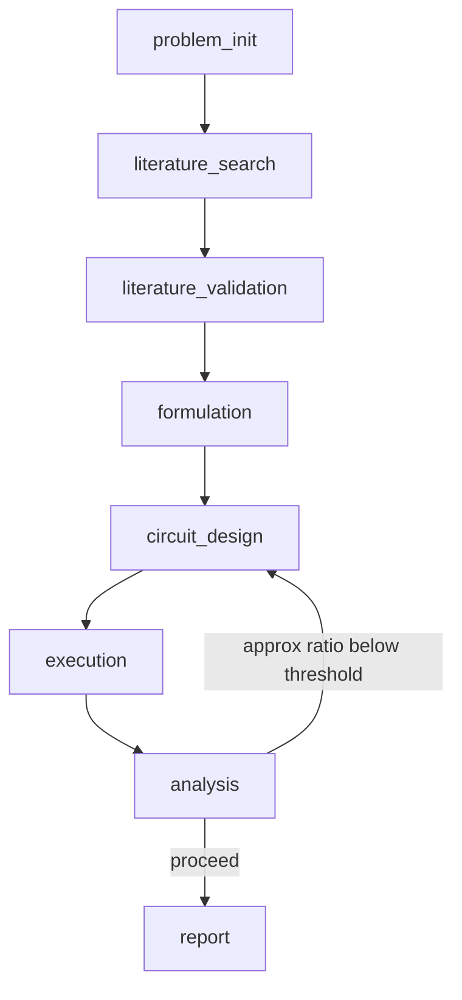

# Agentic QAOA — Portfolio Optimization

An agentic AI pipeline that autonomously designs, literature-grounds, validates, and executes a **warm-start XY-mixer QAOA** circuit for cardinality-constrained portfolio optimization — orchestrated with [LangGraph](https://github.com/langchain-ai/langgraph) and driven by LLM agents (Claude, GPT, and/or Gemini) that generate and justify each design choice against real financial data and real literature.

This is the codebase for the MS thesis **"An Agentic AI Framework for Automated QAOA Design in Portfolio Optimization"** (Abyan Khabir Irfan, advised by Dr. Chansu Yu, Cleveland State University).

---

## What it does

Given a set of assets and a budget constraint, the pipeline:

1. Pulls live market data and constructs a mean–variance portfolio optimization problem.
2. Searches the literature (Semantic Scholar) for the best-supported QAOA methodology for that specific problem shape.
3. Cross-checks that recommendation against a static **RAG corpus of arXiv full text**, explicitly flagging and correcting any claim the full text contradicts — abstracts alone are often not enough to trust.
4. Has an LLM generate the actual Ising Hamiltonian, warm-start vector, and circuit code — executed in a sandboxed namespace, validated against a static Qiskit API doc-store *before* execution, and retried (with RAG-grounded guidance) on failure.
5. Runs CVaR-COBYLA optimization on the resulting circuit.
6. Analyzes the result and writes a final report whose claims are grounded in the *actual generated circuit's gate composition* — not the variant's canonical description — so the report can't silently misdescribe what was really built.

## Pipeline Architecture



| Node | Role |
|---|---|
| `problem_init` | Fetches live market data (or a fixed Woerner benchmark instance) and builds the initial pipeline state. |
| `literature_search` | LLM-driven Semantic Scholar search + synthesis into a methodology recommendation (variant, depth, warm-start, mixer truncation). |
| `literature_validation` | Cross-checks that recommendation against full-text arXiv excerpts (RAG); revises numeric parameters when the full text contradicts the abstract-level synthesis. |
| `formulation` | LLM-generated Ising Hamiltonian, QP-relaxation warm-start vector, and XY-mixer pair set — executed and validated, with retry-on-failure. |
| `circuit_design` | LLM-generated QAOA circuit, statically validated against a Qiskit API doc-store, then behaviorally validated (Hamming-weight preservation) before acceptance. |
| `execution` | CVaR-COBYLA optimization loop against the Aer simulator (or IBM Quantum hardware). |
| `analysis` | Computes approximation ratio, CVaR, and energy; LLM interpretation of the result. |
| `report` | Final technical report — grounded in the verified circuit and literature-validation output, not the variant label. |

## Key Features

- **Constraint-preserving mixer, not penalty tuning.** The XY-mixer enforces the budget constraint by construction (Hamming-weight preservation), verified empirically every run rather than assumed.
- **Two-stage literature grounding.** Abstract-level discovery (Semantic Scholar) is a *starting point*, not a final answer — a dedicated validation node checks it against full-text evidence and documents any correction explicitly.
- **Sandboxed, validated LLM code generation.** Generated Hamiltonian/circuit code runs in a controlled namespace, is checked against a static Qiskit doc-store (constructor arguments *and* method existence) before execution, and gets automatic RAG-guided retries on failure.
- **Grounded reporting.** The final report is built from facts extracted from the real circuit (gate composition) and the real literature-validation output — it cannot describe the idealized/canonical version of a technique that wasn't actually implemented.
- **Heterogeneous LLM routing.** Every LLM-calling node can run on Claude, GPT, or Gemini independently, configured via `NODE_LLM_MAP` in `config/settings.py`.

## Project Structure

```
agentic_qaoa/
├── agents/          8 pipeline nodes (see table above)
├── benchmark/       metrics + sweep utilities (see `python -m benchmark.sweep`)
├── config/          settings.py — LLM backends, NODE_LLM_MAP, QAOA hyperparameters, problem instance
├── data/            arXiv corpus + Qiskit doc store (gitignored — see Setup)
├── data_sources/    live market data fetch (yfinance) → mu/sigma for the QP relaxation
├── graph/           LangGraph state schema, conditional edges, and graph builder
├── llm/             provider-agnostic LLM router (Claude / GPT / Gemini)
├── notebooks/       original Colab prototype, retained for reference
├── rag/             arXiv/Qiskit RAG pipeline: fetch, embed, chunk, doc-store lookup, static code validation
├── results/         per-run analysis/report output, tagged by backend + timestamp (gitignored)
├── scripts/         one-time database setup scripts
├── tests/           test suite
├── tools/           legacy helper scripts (predate the node-based pipeline)
├── main.py          entry point — python main.py
└── pyproject.toml   package config
```

## Setup

**Requirements:** Python 3.13, [uv](https://github.com/astral-sh/uv)

```bash
git clone https://github.com/AbyanIrfan/agentic_qaoa_portfolio_optimization.git
cd agentic_qaoa_portfolio_optimization

uv venv --python 3.13
# Windows:
.venv\Scripts\activate
# macOS/Linux:
source .venv/bin/activate

uv pip install -r requirements.txt
uv pip install -e .
```

**API keys** — copy `.env.example` to `.env` and fill in:

```
ANTHROPIC_API_KEY=...
OPENAI_API_KEY=...
GOOGLE_API_KEY=...
SEMANTIC_SCHOLAR_API_KEY=...   # optional — used for higher rate limits
IBM_QUANTUM_TOKEN=...          # optional — only needed for hardware runs
```

**Build the RAG corpus** (required before the first real run — `data/` is gitignored):

```bash
# Windows
.\scripts\setup_databases.ps1
# macOS/Linux
./scripts/setup_databases.sh
```

This rebuilds the arXiv full-text corpus (via the Semantic Scholar/arXiv APIs + OpenAI embeddings) and the Qiskit API doc-store used for static code validation.

## Usage

Edit the problem instance and hyperparameters in `config/settings.py` (tickers, budget, risk factor, retry threshold, etc.), then:

```bash
python main.py
```

`main.py` calls `run_single(llm_name=...)`, where `llm_name` is one of:

| Value | Behavior |
|---|---|
| `"claude"` / `"gpt"` / `"gemini"` | Every LLM-calling node runs on that single backend. |
| `"hetero"` | Each node uses the backend assigned to it in `config.settings.NODE_LLM_MAP`. |

Results are written to `results/analysis_<backend>_<timestamp>.txt` and `results/report_<backend>_<timestamp>.txt`.

## Configuration

`config/settings.py` centralizes:

- **`LLM_BACKENDS`** — model IDs for each provider (e.g. `claude-sonnet-4-6`, `gpt-5.6-sol`, `gemini-3.1-pro-preview`).
- **`NODE_LLM_MAP`** — which backend each node uses in `"hetero"` mode.
- **QAOA hyperparameters** — `RETRY_THRESHOLD`, `MAX_RETRIES`, `CVAR_ALPHA`, `DEFAULT_P_LAYERS`.
- **Problem instance** — `TICKERS`, `BUDGET`, `RISK_FACTOR`, `LOOKBACK_DAYS`, `END_DATE` (pin this for reproducible, repeatable runs — live data otherwise refetches on every run), `USE_LIVE_DATA` (set `False` to reproduce the fixed Woerner benchmark instance instead).
- **Hardware** — `USE_HARDWARE`, IBM Quantum credentials, for running on real devices instead of the Aer simulator.

## Known Limitations

- Comparative claims about which LLM backend suits which node are based on a small number of repeated runs on a single problem instance — informative, not statistically conclusive.
- `literature_validation`'s retrieval query is built from `literature_search`'s free-text output, so retrieval can be sensitive to the exact phrasing of the upstream recommendation.
- Node-to-node behavior may depend on which backend authored the *upstream* content a node reads, not only which backend executes the node itself — under active investigation.

## License

No license currently specified.
